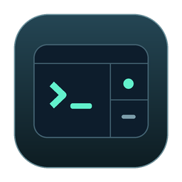
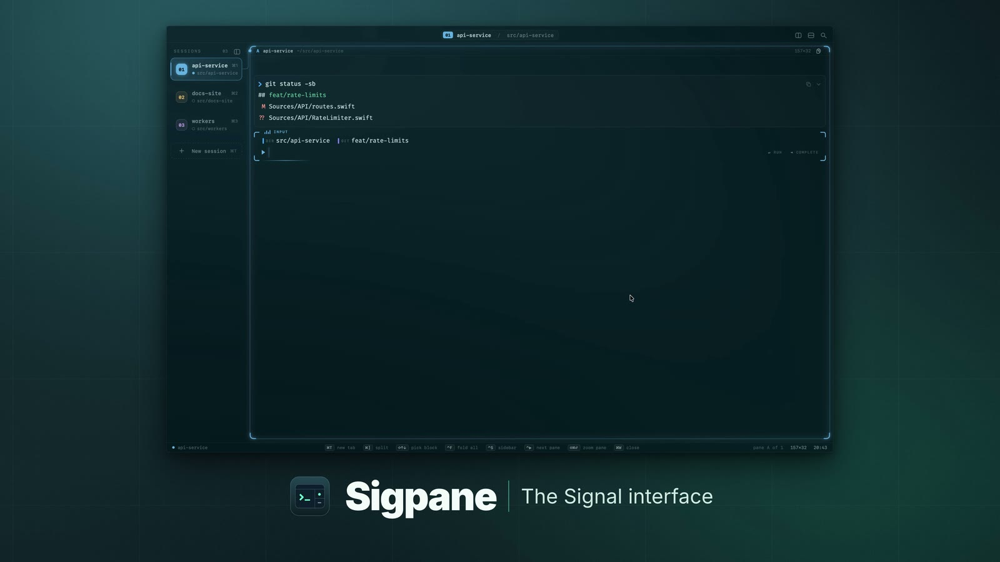

<p align="center">
  
</p>

<h1 align="center">Sigpane</h1>

<p align="center">
  <strong>An independent macOS terminal with an agent-aware workspace.</strong>
  <br />
  Session cards, framed split panes, live Claude Code and Codex activity, and command blocks you can fold.
  <br />
  <br />
  <a href="#what-sigpane-adds">Features</a>
  ·
  <a href="#build-from-source">Build</a>
  ·
  <a href="#configuration">Configuration</a>
  ·
  <a href="#relationship-to-ghostty">Relationship to Ghostty</a>
</p>

<!-- The film lives on the assets branch (sigpane/sigpane-showcase-1080p.mp4), so master stays
     small. For an inline player instead of a link: drag that file into this README in
     GitHub's web editor and replace the block below with the
     https://github.com/user-attachments/assets/... line GitHub inserts. -->
<p align="center">
  <a href="https://raw.githubusercontent.com/amsynist/sigpane/assets/sigpane/sigpane-showcase-1080p.mp4">
    
  </a>
  <br />
  <sub><a href="https://raw.githubusercontent.com/amsynist/sigpane/assets/sigpane/sigpane-showcase-1080p.mp4">Watch the 75-second showcase</a> · sample project and sessions</sub>
</p>

## The Signal interface

- **Session cards.** Each tab is a card with a numbered tile in the tab's color, its title and the focused pane's directory. A new session sweeps into place, and the selection slides from one card to the next.
- **Titlebar.** The title is a capsule with the session's number, name and directory. Buttons at the trailing end split right, split down and open the command palette.
- **Framed panes.** Every pane has a header with its letter, title, directory and size in cells. The focused pane has a tinted outline and corner brackets, and a trace line runs from the selected session to it.
- **Status line.** A strip under the terminal shows the focused pane and the current shortcuts for tab, pane and block actions.
- **One color.** The selection, focus outline, trace, titlebar and status line take the selected tab's color.

> [!NOTE]
> Sigpane is an independent fork of [Ghostty](https://github.com/ghostty-org/ghostty). It is not affiliated with or endorsed by the Ghostty project. The terminal engine, rendering, native tabs and splits, and configuration are Ghostty's work; see [Relationship to Ghostty](#relationship-to-ghostty).

## What Sigpane adds

Sigpane changes how the macOS app looks and what it tells you. The terminal underneath is Ghostty.

|              | Sigpane adds                                                                                                             | Ghostty provides                                                |
| ------------ | -------------------------------------------------------------------------------------------------------------------------- | --------------------------------------------------------------- |
| **Sessions** | Numbered session cards in a sidebar, or compact tabs at the top or bottom, with a selection that slides between them       | Native tabs and windows, restoration, key bindings              |
| **Splits**   | A frame and header for every pane, corner brackets and a trace line that follow focus, split buttons in the titlebar       | The split tree, resizing, zoom and equalize                     |
| **Agents**   | Claude Code and Codex activity in the pane header, session card, status line and sidebar, with a jump to the next approval | The terminal they run in                                        |
| **Commands** | A block around each command and its output, folding in place, copy, and a marker on commands that failed                   | Shell integration, which marks where each prompt begins         |
| **Prompt**   | Five zsh prompt styles                                                                                                     | Shell integration                                               |
| **Engine**   | A small addition for folding rows and reading a command's output                                                           | Terminal emulation, GPU rendering, fonts, themes, configuration |

## Agent activity

A Claude Code or Codex session is treated as a session of its own, in the space the interface already has. Nothing is added above the terminal, so a session starting or ending never changes the terminal's size.

- **Pane header.** Who is working and on what (`Write RateLimiterTests.swift`), with task steps, a dot for each subagent and a context pie. Its lower edge moves while the agent works.
- **Session card.** The second line shows the state and the tool in use. The outline around the tile fills with the context window.
- **Status line.** Follows the focused pane: state and turn time, model, permission mode, context, tokens, cost, files and lines changed.

### Approvals

When an agent in another pane or tab needs an answer, its header and session card turn amber, the sidebar foot counts it, and **Next Approval** takes you to it. A pill in the titlebar appears while a session in another tab is waiting. You answer in the agent's own prompt; Sigpane only shows you where.

Amber means **Needs approval**, cyan **Running**, violet **Compacting**, red **Stopped on error**, and green **Done** until you have looked at the pane.

<kbd>⌘⇧A</kbd> opens the Agents overview, which lists every session in every tab with its subagents. <kbd>⌃⇧A</kbd> goes to the next one waiting for an answer.

### Turning it on

In **Sigpane Settings… → Agent Activity**, enable Claude Code, Codex, or both. The setup uses Python 3.9 or newer. You can also enable the hooks from a checkout:

```sh
python3 scripts/agent-activity.py enable claude
python3 scripts/agent-activity.py enable codex
```

Then start `claude` or `codex` in a Sigpane pane. In Codex, review and trust the Sigpane hooks in `/hooks`. To remove the hooks, run the same commands with `disable`. Enable again after updating Sigpane, since newer versions follow more events.

Context, tokens and cost come from Claude Code's status line. **Context and cost → Enable** (or `usage-enable claude`) records them and then runs the status line command you already had; `usage-disable` puts it back.

**What the hook passes on.** The provider's state reaches the pane through a local temporary directory: the phase, the tool's name and one word about its target (a file's name, a command's first word). Never a prompt, a path or a full command.

## Command blocks

Every command and its output is one block, with a copy button and a fold chevron on the command line.

- **Fold and reopen.** Click a block's chevron, or press <kbd>⌃F</kbd> at the shell prompt. Folding takes the output off the screen and keeps its text, with colors; the command line shows the line count and the first line. Reopening unrolls it in place.
- **Fold long output for you.** Off by default. When on, you set the line threshold and whether the newest output folds too. The output of a command that failed is never folded for you.
- **Pick and copy.** <kbd>⇧↑</kbd> and <kbd>⇧↓</kbd> select a finished block; <kbd>⌃C</kbd> or <kbd>⌘C</kbd> copies its output, folded or not.
- **See what failed.** A command that exits non-zero gets a red **FAILED** marker on its own block.

Blocks come from shell integration's prompt marks, so they appear in shells where Ghostty's shell integration is active.

## Prompt styles

**Sigpane Settings… → Terminal → Prompt style** changes the zsh prompt. The prompt is drawn with zsh builtins only and takes over from a prompt theme such as Starship inside Sigpane.

| Style               | Looks like                                                                                                                                                  |
| ------------------- | ----------------------------------------------------------------------------------------------------------------------------------------------------------- |
| **Breadcrumb Rail** | The path as breadcrumbs with the git branch, and the command on the line below. |
| **Command Capsule** | Directory, branch and command on one line inside a capsule.                  |
| **Tabbed Dock**     | Directory and git tabs above the command line.                                      |
| **HUD Brackets**    | Corner brackets around labeled directory and git fields, with the command below.    |
| **Command Card**    | Directory and git chips above the command line, inside a card.                     |

## Layouts

**Sigpane Settings… → Layout → Position** moves the session strip to the left, right, top or bottom. The sidebar button, or <kbd>⌃S</kbd> at the shell prompt, collapses a sidebar to numbered tiles. Sessions can be grouped by agent.

Choose **Classic** instead of **Signal** in the settings for a simpler capsule tab strip.

## Build from source

Sigpane runs on macOS only. You need Xcode with its macOS SDK and Metal toolchain, Zig at the version in [`build.zig.zon`](build.zig.zon), and Nushell. See [Ghostty's macOS build prerequisites](HACKING.md#macos) for details.

```sh
git clone https://github.com/amsynist/sigpane.git
cd sigpane
zig build -Doptimize=ReleaseFast -Demit-macos-app=false -Dxcframework-target=native
macos/build.nu --configuration ReleaseLocal --arch "$(uname -m)"
open macos/build/ReleaseLocal/Sigpane.app
```

The app builds as `Sigpane.app` with the bundle identifier `com.amsynist.ghosttyx`, so it installs beside the official Ghostty and reads the same Ghostty configuration.

To run the native tests:

```sh
macos/build.nu --configuration ReleaseLocal --arch "$(uname -m)" --action test
```

## Configuration

The custom tab strip uses the `tabs` titlebar style, on macOS 26 and later. Set it in your Ghostty configuration:

```ini
macos-titlebar-style = tabs
```

On macOS 13 to 15 the tabs keep Ghostty's own appearance.

Everything else is in **Sigpane Settings…**, beside **Open Config** in the app menu: Signal or Classic, tab placement and sizing, pane headers, focus effects, status hints, agent activity hooks, the prompt style, command blocks and the optional Signal Void colors. Window opacity and blur follow your Ghostty configuration.

The [implementation notes](SIGPANE.md) describe how each part works, what it changes in the core, and how it was tested.

## Relationship to Ghostty

Sigpane is an independent macOS terminal based on [Ghostty](https://github.com/ghostty-org/ghostty). It has no affiliation with or endorsement from the Ghostty project.

Ghostty's terminal engine, renderer, shell integration, and native tabs and splits are the work of Mitchell Hashimoto and the Ghostty contributors. Their copyright and permission notices are preserved in the [MIT license](LICENSE). See the [original Ghostty README](https://github.com/ghostty-org/ghostty#readme) for upstream documentation.
